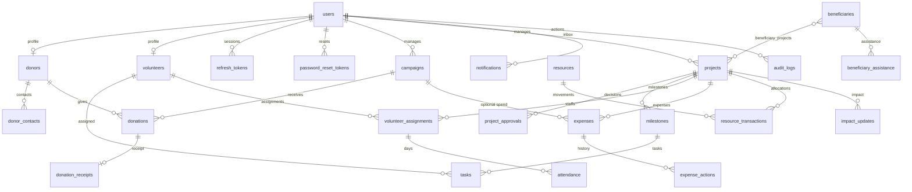

# Database

PostgreSQL in Docker, SQLite for tests and a laptop without Docker. The migration in `alembic/versions` is the schema both of them apply.

Money is `NUMERIC(12, 2)`. Stock quantities are integers with a check that they cannot go negative. Donation references and receipt numbers are unique. A donation has at most one receipt.

`campaigns.goal_amount` is what the fundraiser is trying to raise. `campaigns.raised_amount` is the sum of confirmed donations that have not been reversed or refunded. `campaigns.budget_amount` and `projects.budget_amount` are spending limits. Approved and reimbursed expenses count against those limits.

`projects.approval_state` is separate from `projects.status`. A project can sit in planning while a decision is pending. Status becomes `approved` only when someone with approval permission accepts it.
